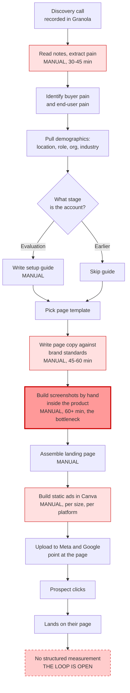
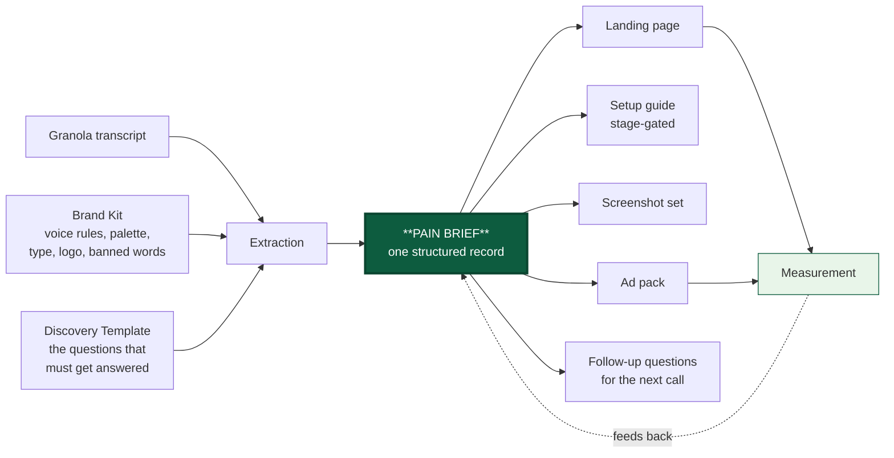
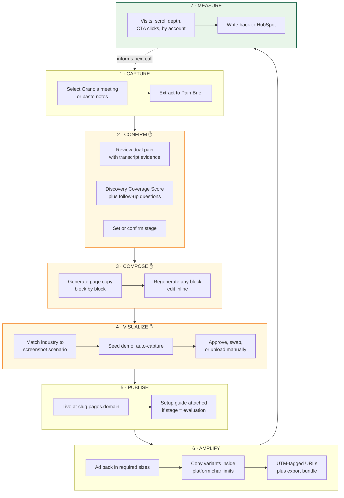
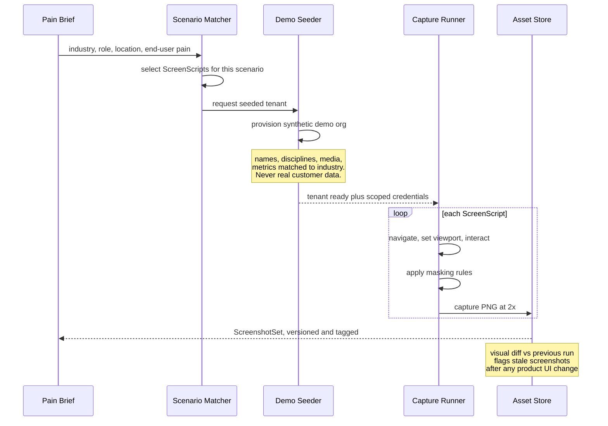
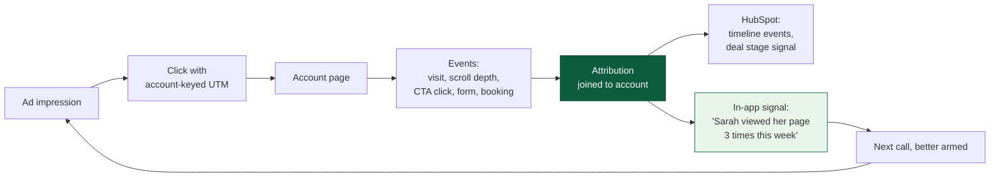
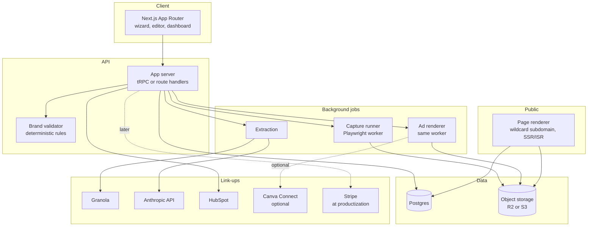

# Throughline: Product Plan

Working codename for the app. The name describes the thing it does, which is hold a single thread from the sales call, through the landing page, into the ads, and back to the deal.

---

## Context

Rich runs a manual sales workflow that works but does not scale. A discovery call is recorded in Granola, the pain is extracted by hand, a landing page is built from a template with brand-correct copy, screenshots are produced manually inside sportsense, a setup guide is written when the account is in evaluation, and static ads are built in Canva and pointed at that page. Each step is a lossy document handoff, each artifact drifts from the others, and the whole chain lives in one person's head.

The goal of this plan is two things at once. First, describe the existing workflow precisely enough to automate it. Second, restructure it so it becomes a product other companies can buy, rather than a faster version of one founder's routine.

**Decisions already locked** (from the scoping conversation):

| Decision | Choice |
|---|---|
| Day-one scope | Single tenant for sportsense, productize after the loop is proven |
| Page hosting | App-hosted subdomain, owned renderer, full analytics |
| Product visuals | Seeded demo instance plus automated headless capture |
| Ad platforms | Generate assets and copy, export for manual upload, no API push in v1 |

**Deliverable of the execution phase:** this document committed to `battleship233` on branch `claude/sales-workflow-web-app-kvr5wv` as `throughline-plan.md`. No application code is written until the plan is approved.

---

## Part 1: The Workflow As It Exists

Mapped from the description, with each step labelled by what it costs today.



**What this diagram says.** There are four manual blocks, one of them severe (screenshots), and the chain terminates without feeding anything back. Nothing that happens after the click informs the next call, the next page, or the next ad.

### The five structural problems

1. **Lossy handoffs.** The pain lives in prose in a Granola note, then again in the page copy, then again in the ad headline. Three copies that can disagree. Change your mind about the pain and you rewrite everything by hand.
2. **The screenshot bottleneck.** The most valuable asset (real product UI shown in the prospect's context) is the slowest to produce, which means it gets reused generically or skipped.
3. **The stage conditional is undocumented.** "If the client is in an evaluation phase I also create a setup guide" is a business rule living in memory. Rules in memory do not scale past one operator.
4. **Discovery quality is unverifiable.** "I make sure to ask all the right questions" is the highest-leverage part of the whole system, and there is currently no way to know whether a given call actually got the answers, or which ones were missed.
5. **The loop is open.** Ads point at the page and the story ends. There is no path from a click back to the account record, so nothing compounds.

---

## Part 2: The Central Idea

The single most important architectural decision in this plan:

> **Every artifact renders from one structured record. Nothing is authored twice.**

Today the workflow is a chain of documents. In the app it becomes one object, the **Pain Brief**, with the page, the guide, the screenshots, and the ads as *projections* of that object. Edit the buyer pain statement once and the hero headline, the guide intro, and all six ad variants regenerate together.

This is what separates a product from a macro. A macro speeds up the steps. A product changes what a step *is*.



### The Pain Brief schema

This is the heart of the product, so it is worth specifying now rather than discovering later.

```
PainBrief
├── account
│   ├── company_name, domain, logo
│   ├── industry            → drives screenshot scenario selection
│   ├── location            → drives geographic language and social proof
│   ├── size, structure
│   └── stage               → discovery | evaluation | negotiation | closed
├── contact
│   ├── name, role, seniority
│   ├── demographics gathered on the call
│   └── stated priorities and constraints
├── buyer_pain              ← the person you are talking to
│   ├── statement           the pain in their words, quoted
│   ├── evidence[]          transcript excerpts, timestamped
│   ├── cost_of_inaction
│   └── confidence          high | medium | inferred
├── end_user_pain           ← the person they serve
│   ├── statement
│   ├── evidence[]
│   └── confidence
├── objections[]            raised on the call, with your response
├── proof_needed[]          what would make this real for them
├── coverage
│   ├── answered[]          which discovery questions landed
│   ├── missing[]           which did not
│   └── score               0-100
└── provenance              meeting id, transcript span, model, timestamp
```

### Why the dual pain field matters more than it looks

Rich described extracting "the key pain in the sale for the person we're talking to, **and** the person we're trying to make a sale for." That is not a detail, it is the differentiator.

Generic AI landing page tools model one pain, the buyer's. This workflow models two, because in a consultative sale the buyer is buying a way to serve *their* customer better. For sportsense the buyer is the coach and the end user is the athlete. The page has to speak to the coach while selling them on solving the athlete's problem.

That structure generalizes cleanly to every business selling infrastructure to a service provider (agencies, clinics, studios, contractors, brokers), and it is a positioning wedge no single-pain competitor can copy without rebuilding their data model.

**Design rule:** every generated artifact must show both pains and must be traceable to a quoted line in the transcript. Never let the model produce an unattributed pain statement. Confidence and provenance are displayed in the UI, not hidden.

---

## Part 3: The Proposed Flow

Six steps, three human checkpoints. The principle is to automate generation completely and keep judgment entirely.



### Step 1 · Capture

Pull the meeting from Granola, or paste notes, or upload a transcript. Extraction runs server-side against Claude with a JSON schema, so the output is a validated Pain Brief and not prose that needs re-parsing. The Brand Kit and Discovery Template form a long stable prefix on the prompt, which makes this a textbook case for prompt caching and materially cuts per-call cost.

**Integration risk, stated honestly.** Granola's MCP server works inside Claude, but a hosted web app needs a server-side path, and Granola's public API surface for third-party apps needs verification before this is designed as the only door. Build the ingestion layer transcript-source-agnostic from day one: Granola connector when available, plus paste, plus file upload, plus a generic transcript webhook. That way no phase is blocked on one vendor's API roadmap.

### Step 2 · Confirm, and the feature hiding inside it

This is the human checkpoint where the Pain Brief gets approved, and it is also where the highest-value feature in the product lives.

Rich said he "makes sure to ask all the right questions." Right now that assurance is unverifiable. In the app it becomes measurable:

**Discovery Coverage Score.** The Discovery Template defines the question set that a good call must answer (buyer pain, end-user pain, cost of inaction, location, role, decision process, current tooling, timeline, budget authority, what proof they need). Extraction checks each one against the transcript and reports:

- which questions were answered, with the quoted evidence
- which were missed
- a generated list of follow-up questions for the next call, phrased for that specific person

That single screen turns tribal sales skill into a repeatable, auditable process. It is also, notably, the feature most likely to sell the product to a sales manager, because it is the only part of the system that improves the humans rather than just the output.

### Step 3 · Compose

Page copy generates block by block against the Brand Kit, not as one blob. Blocks are hero, problem, mechanism, proof, objection handling, CTA. Each is independently regenerable, which is what makes the editing experience feel like a tool instead of a slot machine.

The Brand Kit encodes real constraints, and sportsense already has them written down in `claude sportsense.md`: lowercase product name always, no em dashes, no emoji, flowing connected sentences rather than staccato fragments, lead with the problem not the product, banned phrases like "level up" and "game changer." These become **validators that run on generated output and block publish on violation**, not suggestions in a prompt. Deterministic rules should be enforced deterministically. The model will drift, a linter will not.

### Step 4 · Visualize (the hard part, and the moat)

Chosen approach: seeded demo instance plus automated capture.



**Mechanism.** A ScreenScript is a named, versioned recipe: routes to visit, interactions to perform, viewport, wait conditions, and selectors to mask. An IndustryProfile supplies the seed data (persona names, discipline, org name, sample media, plausible metrics). The runner is Playwright driving Chromium in a dedicated worker container, because a serverless function is the wrong place to hold a browser.

**Two things make this cheaper than it sounds.** Chromium and Playwright are already provisioned in this environment, and the same renderer doubles as the ad-image generator in Step 6, so one worker serves both pipelines.

**Guardrails, non-negotiable.** The demo tenant is synthetic and isolated, real customer data never enters a capture, masking rules run on every shot, and a visual-diff check against the previous run flags every screenshot that a product UI change has invalidated. Stale screenshots in a sales asset are worse than no screenshots.

**Fallback path.** Any scenario that cannot be automated has a manual upload slot filling the identical `ScreenshotSet` slot. The page template never knows or cares which door the image came through. This matters more than it appears, for reasons in Part 6.

### Step 5 · Publish

The page renders server-side at `{account-slug}.pages.{domain}`, resolved by wildcard DNS and middleware looking up the published page record. Custom domains later. The setup guide is a second route on the same account, generated and attached automatically when `stage = evaluation`, which is how the undocumented business rule from Part 1 becomes actual code.

Publishing is versioned. Every publish is a snapshot, rollback is one click, and the page can be unpublished or expired when the deal closes.

### Step 6 · Amplify

Generation covers the sizes the platforms actually require:

| Platform | Sizes |
|---|---|
| Meta feed | 1080×1080, 1080×1350 |
| Meta Stories and Reels | 1080×1920 |
| Google Display | 1200×628, 1200×1200, 960×1200, logos 1200×1200 and 1200×300 |

Copy generates inside real character limits, enforced by the same validator layer: Meta headline roughly 27 to 40 characters and primary text front-loaded before the 125 character truncation, Google responsive display headlines at 30 characters with a 90 character long headline and 90 character descriptions. Enforcing these in the app removes an entire category of rework.

**The Canva finding, and what it changes.** A read-only check of the connected Canva account found more than ten brand templates but **zero with autofill datasets**. Canva's autofill API only works against templates that have named data fields defined, and autofill is plan-gated on top of that. So the ad pipeline cannot be built as a straight Canva API call today.

The plan handles this by not depending on it. The **internal HTML and CSS renderer is the default**, reusing the Playwright worker already built for screenshots, giving full control, no plan gating, and no external rate limits. The **Canva path is an optional export** for brand-team workflows, unblocked by a small setup task (author four to six ad templates with named fields for headline, subhead, CTA, logo, and screenshot slot). Recommend building the internal renderer first and treating Canva as a nice-to-have rather than a dependency on the critical path.

Every generated URL carries UTM parameters keyed to the account, which is the thread that makes Step 7 possible at all.

### Step 7 · Measure, and closing the loop



This is what converts the app from a content generator into a system worth paying for monthly. "Your prospect opened their page three times and spent ninety seconds on the pricing section" is a sales signal that did not exist before, and it is only possible because the page is app-hosted rather than exported. That decision from the scoping conversation pays off precisely here.

---

## Part 4: Architecture



**Stack recommendation.** Next.js App Router on Vercel for the app and the public renderer in one codebase, Postgres via Neon or Supabase with Drizzle, Cloudflare R2 or S3 for assets, Inngest for durable multi-step background jobs (capture and generation both need retries and step functions), a dedicated always-on container on Fly.io or Railway for the Playwright worker, Claude via the Anthropic API with structured outputs for extraction and prompt caching on the Brand Kit prefix, and Clerk or Auth.js for auth.

**The one rule that protects the productization path.** Even though phase one is single tenant, **put `workspace_id` on every table from the first migration and scope every query through it**. Retrofitting tenancy onto a live schema is one of the most expensive mistakes available in this category of app. Cost now is close to zero, cost later is a rewrite. Do it on day one.

---

## Part 5: Build Phases

Each phase should be independently useful. Nothing ships that is only valuable once a later phase lands.

| Phase | Scope | Proves |
|---|---|---|
| **0. Brief** | Schema, Granola or paste ingestion, extraction, Brand Kit, Discovery Coverage Score. Everything downstream still manual. | The extraction is good enough to trust. If it is not, nothing else matters and you have spent two weeks, not two months. |
| **1. Page** | Templates, block-level copy generation, brand validators, publish to subdomain, versioning, analytics. | The page loop end to end. First real time saved. |
| **2. Visuals** | IndustryProfiles, ScreenScripts, seeder, capture worker, visual diff, manual upload fallback. | The bottleneck is gone. This is the phase that changes the economics. |
| **3. Ads** | Internal renderer, size matrix, copy variants with limit enforcement, UTM builder, export bundle. Canva export optional. | The full artifact chain from one brief. |
| **4. Loop** | Setup guide with stage gating, HubSpot sync both directions, attribution, in-app prospect signals. | The system compounds instead of terminating. |
| **5. Product** | Tenancy switched on, self-serve Brand Kit onboarding, Stripe billing, seats, tiered visual strategy. | Someone other than Rich can use it. |

**Sequencing note.** Phase 2 before Phase 3 is deliberate. Ads consume screenshots, so building ads first means building them twice.

---

## Part 6: Strategic Assessment

The parts worth disagreeing about before code gets written.

### What is genuinely defensible

Not "AI writes a landing page from your call." That category is crowded and commoditizing fast. The defensible combination is three things that are only valuable together:

1. **Dual-pain extraction** with transcript-level provenance, which requires a data model competitors do not have.
2. **Real product UI, auto-personalized per prospect industry.** Everyone else ships stock imagery or generated approximations. Actual screenshots of the actual product, seeded to look like the prospect's world, is a materially different asset.
3. **A closed attribution loop** from ad click back to the deal record.

Sell the combination. Any one of the three on its own has competitors.

### The biggest risk in this plan, and it comes from a locked decision

Seeded demo plus auto-capture is the right call for sportsense, because Rich controls the product being screenshotted. It is also **the single largest obstacle to selling this to anyone else**, because it requires integrating with each customer's product to provision demo tenants and author ScreenScripts. That is not a signup flow, it is an implementation project.

This does not invalidate the choice, it shapes the go-to-market. Plan for a **tiered visual strategy** from the start:

| Tier | Visual approach | Onboarding |
|---|---|---|
| Self-serve | Customer uploads a screenshot library once, app handles tagging, selection, and text overlay swaps | Minutes |
| Professional | App-managed library plus composited device-frame mockups | Hours |
| Enterprise | Full seeded demo and auto-capture integration | Paid implementation, weeks |

Because all three write into the identical `ScreenshotSet` abstraction, this costs almost nothing to support if the abstraction is correct in Phase 2. It costs a great deal if auto-capture is allowed to become load-bearing in the page templates. **Design the seam in Phase 2 even though only the enterprise path gets built.**

Framed positively, the implementation requirement is a feature. It creates a high-touch enterprise tier with real switching costs, and it justifies pricing that a self-serve tool cannot reach.

### Pricing shape

Per-seat is the wrong meter, because the value scales with accounts pursued, not people employed. Meter on **active account campaigns**, with published pages and ad packs as the natural units, plus an implementation fee where auto-capture is in scope. A sales team running forty targeted accounts a quarter should pay meaningfully more than one running four.

### Where this could fail

- **Extraction quality is the whole product.** If the Pain Brief is mediocre, every downstream artifact is mediocre and no amount of polish rescues it. This is exactly why Phase 0 ships alone and gets judged on its own before anything is built on top of it.
- **Granola dependency.** Mitigated by the source-agnostic ingestion layer, but worth verifying early rather than discovering in Phase 1.
- **The screenshot decay problem.** Every product UI change silently invalidates every captured asset. The visual diff check is not a nice-to-have, it is what keeps the feature from quietly rotting into a liability.
- **Personalized pages at scale attract policy attention.** Meta and Google both scrutinize high-volume landing page generation. Keep pages substantive and genuinely account-specific, never thin doorway pages, and treat this as a real constraint on any future "generate fifty pages at once" feature.

### One thing worth adding that is not in the current workflow

The Discovery Coverage Score generates follow-up questions for the *next* call. Feed those back into the Discovery Template as it learns which questions actually correlate with closed deals, and the product stops being a content generator and becomes a sales methodology that improves itself. That is a much harder thing to churn away from, and it is nearly free once Phase 4 attribution exists.

---

## Part 7: Verification

How to know each phase actually works, not just that it compiles.

- **Phase 0:** run extraction against ten real past Granola calls where the outcome is already known. Rich grades each Pain Brief against what he would have written by hand. Target is eight of ten needing only light edits. Fail this and stop, do not build Phase 1.
- **Phase 1:** publish a page for a live deal, confirm subdomain resolution, confirm every brand validator fires on deliberately seeded violations (uppercase Sportsense, an em dash, "game changer"), confirm rollback restores the prior version.
- **Phase 2:** run capture across three IndustryProfiles, confirm output is deterministic across repeat runs, confirm masking hides everything intended, then deliberately change a UI element and confirm the visual diff flags the affected screenshots.
- **Phase 3:** generate a full ad pack, verify every asset matches its required pixel dimensions exactly, verify every copy variant is inside platform character limits, upload one set to Meta Ads Manager manually to confirm the assets are accepted.
- **Phase 4:** click a real ad, land on the page, confirm the UTM resolves to the correct account, confirm the event appears in the HubSpot timeline within a minute.
- **Phase 5:** create a second workspace, confirm total data isolation, and confirm no query anywhere returns a row from the other tenant.
- **Throughout:** golden-file tests on extraction so prompt changes surface as visible diffs rather than silent regressions.

---

## Open Questions For Rich

Not blocking, but each one changes a decision downstream.

1. What is the actual conversion event on these pages? A booked call, a form, a trial signup? It determines what Phase 4 measures and what the CTA blocks generate.
2. How many templates do you really need? One flexible template beats five rigid ones, and template count is the fastest way to make Phase 1 balloon.
3. Does the setup guide belong on the same page, as a gated second page, or as a PDF? Gating it is a lead capture opportunity but adds friction at the exact moment you want none.
4. Roughly how many accounts per month would you run through this today? Ten and one hundred imply very different products.
