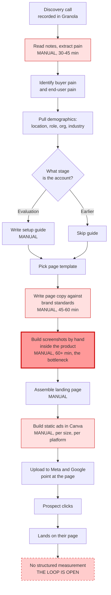
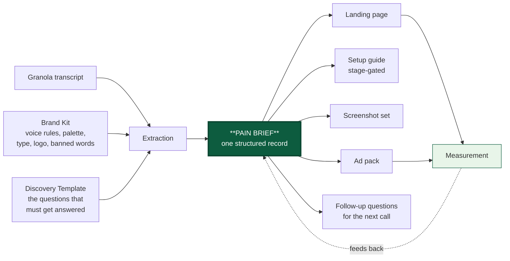
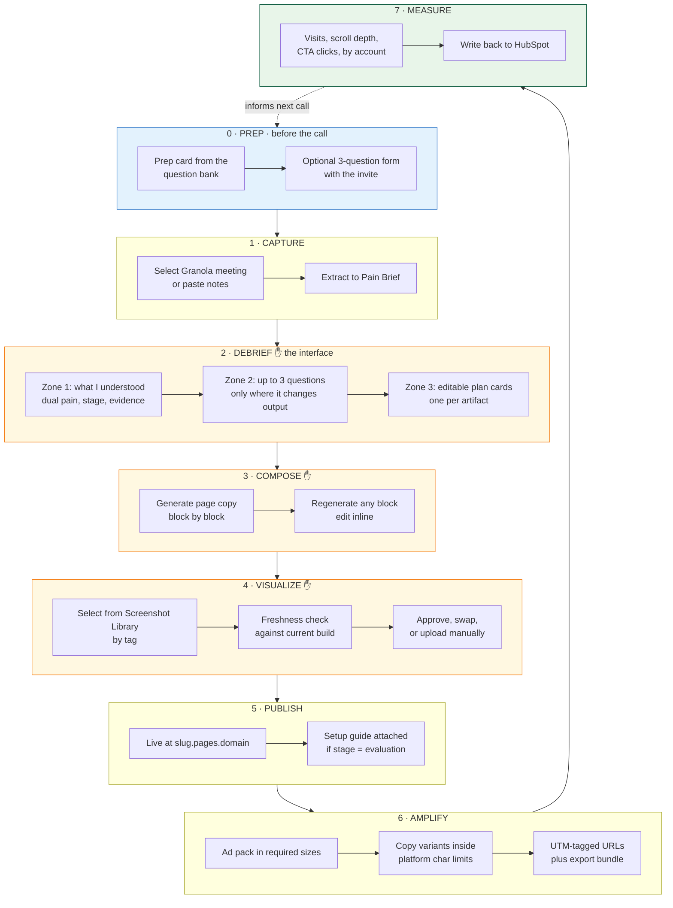
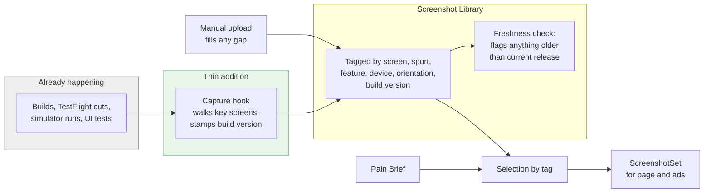
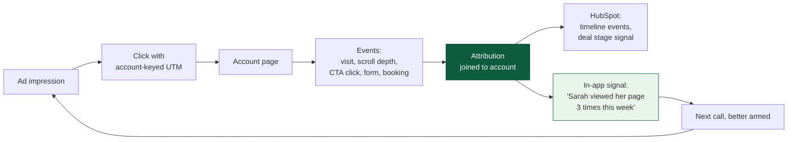
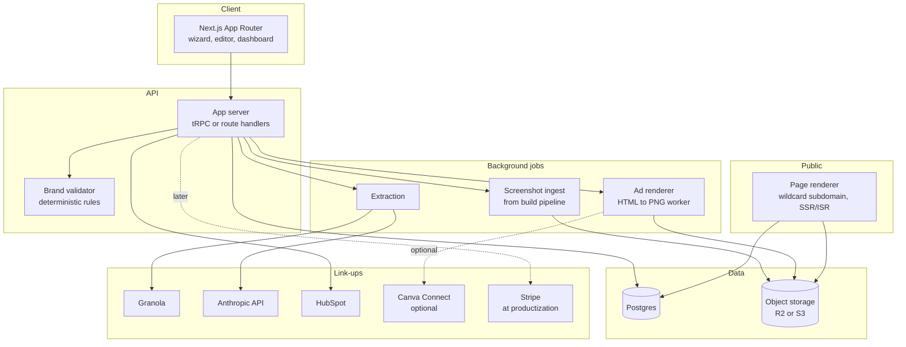

# Throughline: Product Plan

Working codename for the app. The name describes the thing it does, which is hold a single thread from the sales call, through the landing page, into the ads, and back to the deal.

---

## Context

Rich runs a manual sales workflow that works but does not scale. A discovery call is recorded in Granola, the pain is extracted by hand, a landing page is built from a template with brand-correct copy, screenshots are produced manually inside sportsense, a setup guide is written when the account is in evaluation, and static ads are built in Canva and pointed at that page. Each step is a lossy document handoff, each artifact drifts from the others, and the whole chain lives in one person's head.

The goal of this plan is two things at once. First, describe the existing workflow precisely enough to automate it. Second, restructure it so it becomes a product other companies can buy, rather than a faster version of one founder's routine.

**Decisions already locked** (from the scoping conversation):

| Decision | Choice |
|---|---|
| Day-one scope | Single tenant for sportsense, productize after the loop is proven |
| Page hosting | App-hosted subdomain, owned renderer, full analytics |
| Product visuals | Harvest from the existing dev render and build pipeline. Generation deferred as open-ended. Revised Aug 6 |
| Ad platforms | Generate assets and copy, export for manual upload, no API push in v1 |

**Revised Aug 6** after a working session, on four points: the post-meeting Debrief is now specified as *the* interface rather than a checkpoint (Part 3, Step 2), screenshots are harvested from the existing dev build pipeline rather than generated from seeded demo tenants (Part 3, Step 4), stage is auto-detected from the call and overridable (Part 3, Step 2), and a pre-call question bank grounded in eight real July and August calls has been added (Part 4).

**Deliverable of the execution phase:** this document committed to `battleship233` on branch `claude/sales-workflow-web-app-kvr5wv` as `throughline-plan.md`. No application code is written until the plan is approved.

---

## Part 1: The Workflow As It Exists

Mapped from the description, with each step labelled by what it costs today.



**What this diagram says.** There are four manual blocks, one of them severe (screenshots), and the chain terminates without feeding anything back. Nothing that happens after the click informs the next call, the next page, or the next ad.

### The five structural problems

1. **Lossy handoffs.** The pain lives in prose in a Granola note, then again in the page copy, then again in the ad headline. Three copies that can disagree. Change your mind about the pain and you rewrite everything by hand.
2. **The screenshot bottleneck.** The most valuable asset (real product UI shown in the prospect's context) is the slowest to produce, which means it gets reused generically or skipped.
3. **The stage conditional is undocumented.** "If the client is in an evaluation phase I also create a setup guide" is a business rule living in memory. Rules in memory do not scale past one operator.
4. **Discovery quality is unverifiable.** "I make sure to ask all the right questions" is the highest-leverage part of the whole system, and there is currently no way to know whether a given call actually got the answers, or which ones were missed.
5. **The loop is open.** Ads point at the page and the story ends. There is no path from a click back to the account record, so nothing compounds.

---

## Part 2: The Central Idea

The single most important architectural decision in this plan:

> **Every artifact renders from one structured record. Nothing is authored twice.**

Today the workflow is a chain of documents. In the app it becomes one object, the **Pain Brief**, with the page, the guide, the screenshots, and the ads as *projections* of that object. Edit the buyer pain statement once and the hero headline, the guide intro, and all six ad variants regenerate together.

This is what separates a product from a macro. A macro speeds up the steps. A product changes what a step *is*.



### The Pain Brief schema

This is the heart of the product, so it is worth specifying now rather than discovering later.

```
PainBrief
├── account
│   ├── company_name, domain, logo
│   ├── industry            → drives screenshot scenario selection
│   ├── location            → drives geographic language and social proof
│   ├── size, structure
│   └── stage               → discovery | evaluation | negotiation | closed
├── contact
│   ├── name, role, seniority
│   ├── demographics gathered on the call
│   └── stated priorities and constraints
├── buyer_pain              ← the person you are talking to
│   ├── statement           the pain in their words, quoted
│   ├── evidence[]          transcript excerpts, timestamped
│   ├── cost_of_inaction
│   └── confidence          high | medium | inferred
├── end_user_pain           ← the person they serve
│   ├── statement
│   ├── evidence[]
│   └── confidence
├── objections[]            raised on the call, with your response
├── proof_needed[]          what would make this real for them
├── coverage
│   ├── answered[]          which discovery questions landed
│   ├── missing[]           which did not
│   └── score               0-100
└── provenance              meeting id, transcript span, model, timestamp
```

### Why the dual pain field matters more than it looks

Rich described extracting "the key pain in the sale for the person we're talking to, **and** the person we're trying to make a sale for." That is not a detail, it is the differentiator.

Generic AI landing page tools model one pain, the buyer's. This workflow models two, because in a consultative sale the buyer is buying a way to serve *their* customer better. For sportsense the buyer is the coach and the end user is the athlete. The page has to speak to the coach while selling them on solving the athlete's problem.

That structure generalizes cleanly to every business selling infrastructure to a service provider (agencies, clinics, studios, contractors, brokers), and it is a positioning wedge no single-pain competitor can copy without rebuilding their data model.

**Design rule:** every generated artifact must show both pains and must be traceable to a quoted line in the transcript. Never let the model produce an unattributed pain statement. Confidence and provenance are displayed in the UI, not hidden.

---

## Part 3: The Proposed Flow

One prep step before the call, six after it, three human checkpoints. The principle is to automate generation completely and keep judgment entirely. Step 2, the Debrief, is where a user actually spends their time, and everything either side of it should be invisible when it is working.



### Step 1 · Capture

Pull the meeting from Granola, or paste notes, or upload a transcript. Extraction runs server-side against Claude with a JSON schema, so the output is a validated Pain Brief and not prose that needs re-parsing. The Brand Kit and Discovery Template form a long stable prefix on the prompt, which makes this a textbook case for prompt caching and materially cuts per-call cost.

**Integration risk, stated honestly.** Granola's MCP server works inside Claude, but a hosted web app needs a server-side path, and Granola's public API surface for third-party apps needs verification before this is designed as the only door. Build the ingestion layer transcript-source-agnostic from day one: Granola connector when available, plus paste, plus file upload, plus a generic transcript webhook. That way no phase is blocked on one vendor's API roadmap.

### Step 2 · The Debrief, which is the actual interface

This is the product. Everything else is plumbing that feeds it or renders from it.

The Debrief is a single screen that arrives automatically once the meeting ends. It briefs you on what the app understood, asks you a very small number of questions, and hands you an editable plan. You should be able to work it in about two minutes while the call is still fresh, and nothing downstream happens until you approve it.

Three zones, in this order.

**Zone 1: What I understood.** The Pain Brief rendered for reading, not for editing. Buyer pain and end-user pain up top, each with the transcript quote sitting behind it, then stage, account facts, objections raised, and proof requested. Every field is click-to-edit in place, but nothing demands attention. The default action is to keep scrolling.

**Zone 2: What I need from you.** Never more than three questions.

This constraint is the whole design. A question earns a slot only when it clears both bars: extraction is genuinely uncertain about it, **and** the answer changes a downstream artifact. Everything else gets a sensible default and stays quietly editable in Zone 1. Score every candidate gap by uncertainty multiplied by downstream impact, surface the top three, discard the rest. If extraction came back confident across the board, show zero questions and go straight to the plan. A debrief that asks nothing is a success state, not a failure.

The questions are generated, specific, and answerable in a sentence. Not "what is the budget" but "James mentioned the course is ninety-nine dollars and a monthly fee on top is a barrier. Is the pricing conversation now about bundling into the existing fee, or still about per-seat?"

**Zone 3: The plan.** The chunked, interactive part. One card per artifact the app intends to produce:

```
┌─ LANDING PAGE ─────────────────────────┐
│ Leads with: video retrieval chaos      │
│ Proof: Climbing Canada, PSIA           │
│ Visuals: feeds + comparison, 3 shots   │
│ CTA: book pilot scoping call           │
│ [edit] [regenerate] [skip]             │
├─ SETUP GUIDE ──────────────── auto-on ─┤
│ Triggered by: stage = evaluation       │
│ Covers: capture, compare, share        │
│ [edit] [regenerate] [skip]             │
├─ AD SET ───────────────────────────────┤
│ 6 assets, Meta + Google                │
│ Angle: "impossible to find the clip"   │
│ [edit] [regenerate] [skip]             │
└────────────────────────────────────────┘
```

Each card names the pain it leads with, the proof it uses, the assets it needs, and the CTA. Edit a card and only that card regenerates. Skip a card and it never gets built. Approve the set and generation runs in the background while you move on.

This is the difference between the app producing a document you then have to review, and the app producing a plan you steer before any work happens. Steering is cheap, reviewing is expensive.

**Stage detection, sitting inside Zone 1.** Stage is inferred from the call, shown with its confidence and the line that triggered it, and always overridable by one click. Signals drawn from the real pipeline:

| Stage | What triggers it in an actual transcript |
|---|---|
| Discovery | Current setup being explored, no trial or pilot language |
| **Evaluation** | Trial and pilot language. "Restart the trial and send setup guide" (Folke), "extend a free trial through World Youth" (Kraig), "extend Jeff's trial to two weeks", pilot dates being fixed (Volleyball Canada, Aug 29) |
| Negotiation | Pricing models being compared, who-pays discussion, approval from a boss or board required, business model options requested |
| Closed | Contract, PO, start date |

Worth noting how strong the evaluation signal already is. In three of the eight calls reviewed, the literal recorded next step was to send a setup guide or step-by-step resource guides. The conditional Rich described as a business rule in his head is already the single most common next action in his pipeline, which means automating it is not a speculative feature, it is the highest-frequency task he does after a call.

**Discovery Coverage, folded in rather than bolted on.** The Debrief also scores the call against the pre-call question bank in Part 4: what got answered, what was missed, and what to ask next time. It renders as a quiet line in Zone 1, not a report card, and it is what makes the question bank in Part 4 self-improving.

### Step 3 · Compose

Page copy generates block by block against the Brand Kit, not as one blob. Blocks are hero, problem, mechanism, proof, objection handling, CTA. Each is independently regenerable, which is what makes the editing experience feel like a tool instead of a slot machine.

The Brand Kit encodes real constraints, and sportsense already has them written down in `claude sportsense.md`: lowercase product name always, no em dashes, no emoji, flowing connected sentences rather than staccato fragments, lead with the problem not the product, banned phrases like "level up" and "game changer." These become **validators that run on generated output and block publish on violation**, not suggestions in a prompt. Deterministic rules should be enforced deterministically. The model will drift, a linter will not.

### Step 4 · Visualize, revised to harvest rather than generate

The original plan proposed provisioning seeded demo tenants and driving a browser to capture them. That is now deprecated in favour of something considerably cheaper that uses work the dev team already does.

**The insight: renders are already being produced.** Every build, every TestFlight cut, every simulator session a developer runs is already walking through the app's screens. Nothing needs to be simulated because the real thing is being rendered several times a week. The app's job is to catch what already exists, not to manufacture it.



**What gets built.** A capture hook in the existing build pipeline that walks a defined list of key screens and stores the output tagged and version-stamped. If there are already UI or snapshot tests, they navigate the app for free, so hang the capture off those rather than writing new navigation. Then a **Screenshot Library** with real tagging, and a selector that maps Pain Brief fields onto tags. Selection is the product feature. Capture is a build-pipeline chore.

**Freshness solves itself.** Every shot carries the build version it came from, so the library can flag any asset captured before the current release without needing visual diffing. A screenshot from three releases ago is identifiable by metadata alone.

**Manual upload remains a first-class path**, filling the identical `ScreenshotSet` slot. Nothing downstream knows or cares which door an image came through, which is the seam that keeps all of this swappable.

**Generation stays deferred and explicitly open-ended.** Industry-specific seeding, text-swapped overlays, and composited mockups are all still interesting and none of them are on the critical path. Revisit once the library is populated and it becomes clear which gaps selection alone cannot fill.

**This change is more consequential than it looks.** It removes the largest strategic risk identified in the first draft. "Point us at your build pipeline, or upload your library" is an onboarding step almost any software company can complete. "Let us provision demo tenants inside your product" was an implementation project that would have gated every sale. The productization path gets materially easier, and Phase 3 gets substantially shorter.

### Step 5 · Publish

The page renders server-side at `{account-slug}.pages.{domain}`, resolved by wildcard DNS and middleware looking up the published page record. Custom domains later. The setup guide is a second route on the same account, generated and attached automatically when `stage = evaluation`, which is how the undocumented business rule from Part 1 becomes actual code.

Publishing is versioned. Every publish is a snapshot, rollback is one click, and the page can be unpublished or expired when the deal closes.

### Step 6 · Amplify

Generation covers the sizes the platforms actually require:

| Platform | Sizes |
|---|---|
| Meta feed | 1080×1080, 1080×1350 |
| Meta Stories and Reels | 1080×1920 |
| Google Display | 1200×628, 1200×1200, 960×1200, logos 1200×1200 and 1200×300 |

Copy generates inside real character limits, enforced by the same validator layer: Meta headline roughly 27 to 40 characters and primary text front-loaded before the 125 character truncation, Google responsive display headlines at 30 characters with a 90 character long headline and 90 character descriptions. Enforcing these in the app removes an entire category of rework.

**The Canva finding, and what it changes.** A read-only check of the connected Canva account found more than ten brand templates but **zero with autofill datasets**. Canva's autofill API only works against templates that have named data fields defined, and autofill is plan-gated on top of that. So the ad pipeline cannot be built as a straight Canva API call today.

The plan handles this by not depending on it. The **internal HTML and CSS renderer is the default**, giving full control, no plan gating, and no external rate limits. The **Canva path is an optional export** for brand-team workflows, unblocked by a small setup task (author four to six ad templates with named fields for headline, subhead, CTA, logo, and screenshot slot). Recommend building the internal renderer first and treating Canva as a nice-to-have rather than a dependency on the critical path.

Every generated URL carries UTM parameters keyed to the account, which is the thread that makes Step 7 possible at all.

### Step 7 · Measure, and closing the loop



This is what converts the app from a content generator into a system worth paying for monthly. "Your prospect opened their page three times and spent ninety seconds on the pricing section" is a sales signal that did not exist before, and it is only possible because the page is app-hosted rather than exported. That decision from the scoping conversation pays off precisely here.

---

## Part 4: The Pre-Call Question Bank

A second artifact, produced *before* the meeting rather than after it. The app generates a prep card for the seller, and optionally a short form for the prospect, then the Debrief scores the resulting call against it. That closes the loop: the bank shapes the call, the call feeds the brief, the brief reveals what the bank missed.

The questions below are derived from eight real calls in the July and August pipeline (Folke at the Denmark school, James at Volleyball Canada, Kraig at Climbing Canada across two calls, Jeff Compton in hockey, Tommy at kailo.fit, the Zac and Alex product session, and the July 8 sales meeting). They are not generic discovery questions. Tier 1 is what demonstrably produced the useful answers, Tier 2 is what was demonstrably missing and cost time later.

### Tier 1: The six that consistently produced the answer

**1. Walk me through what happens to a video after you film it. Where does it go, who names it, and how does someone find it three weeks later?**

The single highest-yield question in the bank. It produced the core pain in three separate calls, unprompted and in the prospect's own words: Folke's "uploaded to a school server, kids find them manually, impossible" and "files have no names or tags", Jeff's "getting to the clips was a pain in the ass" with frame-by-frame scrubbing and manual renaming, and Hong Kong's scattered players needing something beyond Google Drive. Retrieval cost, not analysis capability, is the recurring buyer pain across the entire pipeline. Lead with this.

**2. When one of your athletes watches their own footage, do they know what they're looking at?**

This is the end-user pain question, and it is what makes the dual-pain model real rather than theoretical. Jeff's alumni said video "felt like work, didn't understand why we needed it", and his players "don't know what they're looking at, so sessions feel unproductive". Folke's students "engage but sessions must stay short, they want to ride, not sit". The coach's problem is retrieval. The athlete's problem is comprehension. Different pains, one sale.

**3. What are you using today, and what does it cost you?**

Produced TPE, Instat and its acquisition by Hudl, Google Drive, and Low Hockey across the pipeline, and produced Jeff's roughly one hundred dollars a month video storage bill, which is what made twenty-five a month land as obviously cheaper. A stated incumbent price is the most useful number available in a first call.

**4. How many coaches, how many athletes, how many locations?**

Sizing that arrived reliably when asked: forty students and three coaches at Folke's school, twelve hundred workshop attendees against nine thousand active coaches at Volleyball Canada, six to twelve coaches in Kraig's network, five locations and two hundred and fifty employees at The Hive.

**5. Who pays for this, and out of which budget?**

Produced the three-model conversation with Kraig (per-seat, NSO subsidy, or gym-carried), the bundling idea with James (a ninety-nine dollar course or two hundred dollar evaluation absorbing the app fee), and the clean answer from Folke that the school buys licences as a business tool. Ask it early. It reframes the entire pricing conversation from "is this affordable" to "which envelope does it come out of".

**6. If this works, what does it replace or make unnecessary?**

The cost-of-inaction question, phrased so it does not sound like one.

### Tier 2: The five that were missing, and cost time later

This cluster is where the real value is. Every one of these showed up as a blocker *after* the meeting, when it could have been qualified before it.

**7. Besides you, who has to say yes, and what do they need to see?**

Every single call had a hidden approver, and not one was identified in advance. Folke had to consult Jacob and Heidi. James had to forward everything to his boss and field the questions that came back. Kraig had to flag the pilot to the CEC board president and vice-president. A champion who cannot sign is a completely different sale, and the app should never let a Debrief close without an answer in this field.

**8. What would your organisation need to know about a company our size before taking this on?**

James's boss asked exactly this, and it arrived as a surprise that required assembling grants, partner associations, and credibility material after the fact. Being asked to prove you are not too small to depend on is entirely predictable in enterprise and certification sales. Ask it yourself, first, and arrive with the answer.

**9. If we stopped operating in two years, what happens to your content and your data?**

Rich had no answer for this when it came back from James's boss, and it became an action item to invent one under pressure. Raising it unprompted is disarming rather than damaging, because it signals you have thought about their risk before they had to.

**10. Are there language, data residency, or procurement requirements we should know about now?**

French language support and Canadian data hosting both surfaced mid-demo at Volleyball Canada, late enough to become commitments made on the spot rather than scoped decisions.

**11. What does your year look like? When is your season, and when do budget decisions actually get made?**

Ontario and Quebec coaches run September to May, western Canada January to May, with minimal summer usage. A pilot scheduled into dead season looks like failure and is not. Seasonality also determines when a contract can realistically be signed.

### Tier 3: Segment-specific, appended automatically

The app selects the block matching the account type.

**Certification body or national sport organisation** (NCCP, Climbing Canada, Volleyball Canada, PSIA):

- Where would this sit in your certification pathway, and does it touch the rubric coaches are scored against? *James confirmed the rubric already scores coaches on their ability to use good reference video, which makes the reference library a direct fit with an existing evaluation criterion rather than an add-on. That is the strongest wedge found anywhere in these eight calls.*
- Does your terminology exist as a documented standard yet, or would we be helping define it? *Kraig's answer, that CEC-endorsed terminology embedded in the app would become a de facto national standard, turns a content gap into a moat.*
- Who distributes it to coaches, and could access be bundled into a fee that already exists?

**Academy, club, or gym** (Shanigan Lake, The Hive, Folke's school):

- Who is the tech-forward coach who would run a pilot for you? *Olivier for Kraig, Folke himself for the Denmark school. Named internal champions were present in every deal that progressed.*
- Do you have a reference library today, or does each coach define the terms their own way? *Jeff's example of "effort" having no shared definition until they built reference clips for it is the clearest articulation of this pain in the whole set.*
- Is there a moment in your season where filming already happens that we could attach to? *World Youth for Kraig, the August 29 workshop for James. Attaching to an existing event beats scheduling a new one.*

### How it is delivered

**Default, seller-facing prep card.** Generated when the meeting is booked, delivered by email or Slack an hour before, and pre-populated with whatever the app already knows about the account from prior calls and CRM. Tier 1 and 2 always, Tier 3 by segment, plus any unanswered questions carried forward from the last Debrief with that account.

**Optional, prospect-facing form.** Three questions maximum, drawn from Tier 1 and the segment block, sent with the calendar invite. Three is a considered limit. Any more and it reads as a qualification gate, which costs goodwill with exactly the senior people worth talking to. The answers pre-fill the brief and shorten the call.

**The bank learns.** Every question carries a hit rate (how often the call produced an answer) and, once attribution exists, a correlation with deals that progressed. Questions that consistently precede movement get promoted, questions that never produce anything get retired. This is what turns the product from a content generator into a sales methodology that improves itself, and it is nearly free once the Debrief is already scoring coverage.

---

## Part 5: Architecture



**Stack recommendation.** Next.js App Router on Vercel for the app and the public renderer in one codebase, Postgres via Neon or Supabase with Drizzle, Cloudflare R2 or S3 for assets, Inngest for durable multi-step background jobs, a dedicated container for the ad renderer (a serverless function is the wrong place to hold a browser), Claude via the Anthropic API with structured outputs for extraction and prompt caching on the Brand Kit prefix, and Clerk or Auth.js for auth.

**The one rule that protects the productization path.** Even though phase one is single tenant, **put `workspace_id` on every table from the first migration and scope every query through it**. Retrofitting tenancy onto a live schema is one of the most expensive mistakes available in this category of app. Cost now is close to zero, cost later is a rewrite. Do it on day one.

---

## Part 6: Build Phases

Each phase should be independently useful. Nothing ships that is only valuable once a later phase lands.

| Phase | Scope | Proves |
|---|---|---|
| **0. Brief and Debrief** | Schema, Granola or paste ingestion, extraction, Brand Kit, stage detection, the three-zone Debrief screen with plan cards. Everything downstream still manual. | The extraction is good enough to trust and the Debrief is genuinely faster than doing it by hand. If it is not, nothing else matters and you have spent two weeks, not two months. |
| **1. Questions** | Pre-call question bank, prep card generation and delivery, coverage scoring inside the Debrief, carry-forward of unanswered questions. | Standalone value with no page generation at all. This phase is useful even if the rest is never built, which makes it the safest thing to ship second. |
| **2. Page** | Templates, block-level copy generation, brand validators, publish to subdomain, versioning, analytics. | The page loop end to end. First real time saved on artifacts. |
| **3. Visuals** | Capture hook in the existing build pipeline, Screenshot Library with tagging, version stamping and freshness flags, tag-based selection, manual upload. | The bottleneck is gone. Much smaller than the original plan for this phase. |
| **4. Ads** | Internal renderer, size matrix, copy variants with limit enforcement, UTM builder, export bundle. Canva export optional. | The full artifact chain from one brief. |
| **5. Loop** | Setup guide with stage gating, HubSpot sync both directions, attribution, in-app prospect signals, question bank hit rates. | The system compounds instead of terminating. |
| **6. Product** | Tenancy switched on, self-serve Brand Kit onboarding, Stripe billing, seats. | Someone other than Rich can use it. |

**Sequencing notes.** Questions moved ahead of Page deliberately, because it is the cheapest phase, it is useful in isolation, and it starts improving call quality immediately while the heavier generation work is still being built. Visuals stays ahead of Ads because ads consume screenshots, so building ads first means building them twice.

---

## Part 7: Strategic Assessment

The parts worth disagreeing about before code gets written.

### What is genuinely defensible

Not "AI writes a landing page from your call." That category is crowded and commoditizing fast. The defensible combination is three things that are only valuable together:

1. **Dual-pain extraction** with transcript-level provenance, which requires a data model competitors do not have.
2. **A question bank with measured hit rates**, tied to deals that actually progressed. This is the piece that compounds, because it gets more valuable with every call run through it and cannot be copied by writing a better prompt.
3. **A closed attribution loop** from ad click back to the deal record.

Sell the combination. Any one of the three on its own has competitors. Note that real product screenshots were listed here in the first draft and have been demoted, because harvesting from a build pipeline is straightforward enough that it is table stakes rather than a moat. That is a good trade: cheaper to build, and the defensibility moves to something that accumulates.

### The risk that the Aug 6 revision removed

The first draft flagged seeded demo capture as the single largest obstacle to selling this to anyone else, because it meant integrating with each customer's product to provision demo tenants. That was an implementation project standing in front of every sale.

Harvesting from an existing build pipeline collapses that problem. "Connect your build pipeline, or upload your library once" is an onboarding step, not a project, and it degrades gracefully: a customer with no automated builds simply uploads, and the `ScreenshotSet` abstraction means nothing downstream notices the difference. **Keep that seam clean, because it is now the thing carrying the productization path.**

### The risk that replaces it

With screenshots demoted from moat to plumbing, the defensibility argument leans harder on the Debrief and the question bank. Those are the parts a competitor would have to out-execute, and they are also the parts most exposed to a general-purpose assistant doing something roughly similar. The mitigation is the learning loop in Part 4: a question bank with real hit rates against real closed deals is proprietary in a way that a prompt is not. Prioritise getting attribution wired (Phase 5) sooner than a purely feature-driven roadmap would suggest.

### Pricing shape

Per-seat is the wrong meter, because the value scales with accounts pursued, not people employed. Meter on **active account campaigns**, with published pages and ad packs as the natural units. A sales team running forty targeted accounts a quarter should pay meaningfully more than one running four. Note that the original implementation-fee tier disappears along with seeded capture, which simplifies pricing but also removes a revenue line that would have justified high-touch onboarding.

### Where this could fail

- **Extraction quality is the whole product.** If the Pain Brief is mediocre, every downstream artifact is mediocre and no amount of polish rescues it. This is exactly why Phase 0 ships alone and gets judged on its own before anything is built on top of it.
- **Granola dependency.** Mitigated by the source-agnostic ingestion layer, but worth verifying early rather than discovering in Phase 1.
- **The screenshot decay problem.** Every product UI change silently invalidates every captured asset. Build-version stamping is not a nice-to-have, it is what keeps the library from quietly rotting into a liability.
- **Personalized pages at scale attract policy attention.** Meta and Google both scrutinize high-volume landing page generation. Keep pages substantive and genuinely account-specific, never thin doorway pages, and treat this as a real constraint on any future "generate fifty pages at once" feature.

### One thing worth adding that is not in the current workflow

Coverage scoring in the Debrief generates follow-up questions for the *next* call. Feed those back into the question bank in Part 4 as it learns which questions actually correlate with closed deals, and the product stops being a content generator and becomes a sales methodology that improves itself. That is a much harder thing to churn away from, and it is nearly free once Phase 5 attribution exists.

---

## Part 8: Verification

How to know each phase actually works, not just that it compiles.

- **Phase 0:** run extraction against the eight July and August calls already reviewed, where the outcomes are known. Grade each Pain Brief against what would have been written by hand. Three specific checks, because these are the cases that break naive extraction: does Folke's call correctly land on `evaluation` from the restart-trial-and-send-guide next step, does Jeff's call separate the coach's retrieval pain from the players' comprehension pain into two distinct fields, and does the Volleyball Canada call surface the boss as an unnamed approver rather than treating James as the decision maker. Target is six of eight needing only light edits. Fail this and stop.
- **Phase 0, separately:** time the Debrief. If it takes longer than two minutes on a real call, the question budget is being exceeded or Zone 1 is asking for too much attention. This is a usability gate, not a nice-to-have.
- **Phase 1:** generate a prep card for a scheduled call, run the call, and confirm the Debrief correctly scores which questions were answered. Confirm unanswered questions carry forward to the next meeting with the same account.
- **Phase 2:** publish a page for a live deal, confirm subdomain resolution, confirm every brand validator fires on deliberately seeded violations (uppercase Sportsense, an em dash, "game changer"), confirm rollback restores the prior version.
- **Phase 3:** run a build, confirm screenshots land in the library correctly tagged and version-stamped, confirm the freshness check flags assets from a prior release, and confirm tag-based selection returns sensible shots for three different account profiles.
- **Phase 4:** generate a full ad pack, verify every asset matches its required pixel dimensions exactly, verify every copy variant is inside platform character limits, upload one set to Meta Ads Manager manually to confirm the assets are accepted.
- **Phase 5:** click a real ad, land on the page, confirm the UTM resolves to the correct account, confirm the event appears in the HubSpot timeline within a minute.
- **Phase 6:** create a second workspace, confirm total data isolation, and confirm no query anywhere returns a row from the other tenant.
- **Throughout:** golden-file tests on extraction so prompt changes surface as visible diffs rather than silent regressions.

---

## Open Questions For Rich

Not blocking, but each one changes a decision downstream.

1. What is the actual conversion event on these pages? A booked call, a form, a trial signup? It determines what Phase 5 measures and what the CTA blocks generate.
2. How many templates do you really need? One flexible template beats five rigid ones, and template count is the fastest way to make Phase 2 balloon.
3. Does the setup guide belong on the same page, as a gated second page, or as a PDF? Gating it is a lead capture opportunity but adds friction at the exact moment you want none.
4. Roughly how many accounts per month would you run through this today? Ten and one hundred imply very different products.
